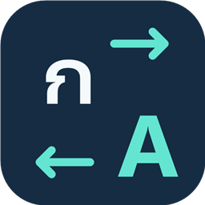

# ⌨️ TabThai v0.1.0

  

**A lightweight Thai ↔ English keyboard-layout correction utility for Windows, written in Rust.**

แอปเบา ๆ สำหรับแก้ข้อความที่พิมพ์ผิดแป้นภาษาไทย/อังกฤษ โดยอิงตำแหน่งปุ่มบนคีย์บอร์ด รองรับ **Thai Kedmanee ↔ English US**

**Author:** Chatchai Jomta  
**Email:** [chatchai.j98@gmail.com](mailto:chatchai.j98@gmail.com)  
**License:** [MIT](LICENSE)  
**Platform:** Windows 10/11 x64

## 💡 ตัวอย่าง

| ข้อความที่พิมพ์ผิดแป้น | หลังแปลง |
| --- | --- |
| c]h; | แล้ว |
| ้ำสสน | hello |
| ืนะรดั | notify |

โปรแกรมแปลงตามตำแหน่งปุ่ม ไม่ใช่การแปลภาษา และไม่ใช่ตัวแก้สะกดคำทั่วไป

## ✨ ฟีเจอร์

- กด **Alt ซ้ายสองครั้ง** เพื่อแปลงคำก่อนเคอร์เซอร์ ค่าเริ่มต้นกำหนดให้แตะสองครั้งภายใน 400 มิลลิวินาที
- ตั้งคีย์ลัดเองได้ ทั้งแบบแตะปุ่ม modifier สองครั้งและแบบกดปุ่มร่วมกัน
- สั่งแปลงเองได้แม้พจนานุกรมไม่รู้จักคำ เช่น ชื่อเฉพาะและศัพท์งาน
- **Auto หลัง Space** แบบเลือกเปิดเอง ใช้พจนานุกรมของ Windows แบบออฟไลน์ร่วมกับชุดคำพื้นฐาน
- กดคีย์ลัดเดิมซ้ำเพื่อย้อนกลับการแก้ล่าสุดภายใน 10 วินาที หากข้อความและตำแหน่งยังไม่เปลี่ยน
- ป้าย TH/EN ข้างเคอร์เซอร์พิมพ์ ป้ายสีเหลืองเมื่อคำดูน่าสงสัย พร้อมคีย์ลัดจริงที่ตั้งไว้
- ป้ายคงตำแหน่งในช่วงพิมพ์บรรทัดเดิม และขยับใหม่เมื่อขึ้นบรรทัดหรือเคอร์เซอร์ออกห่าง เพื่อลดการสั่น
- รองรับคำก่อนเคอร์เซอร์ยาวสูงสุด **512 ตัวอักษร**
- เลือกเปิดพร้อม Windows หลังเข้าสู่บัญชีผู้ใช้ได้จาก Settings โดยไม่ต้องใช้สิทธิ์ Administrator
- ยกเว้นรายแอป พักการแปลง หรือปิดเฉพาะป้ายได้จาก system tray
- ข้ามช่องรหัสผ่านและช่องอ่านอย่างเดียวที่ Windows/provider ระบุได้
- ไม่มี WebView ไม่มีบริการเครือข่าย และไม่ใช้ clipboard

## 🚀 เริ่มใช้งาน

1. แตกแพ็กเกจ Windows ทั้งโฟลเดอร์ ไม่ต้องติดตั้ง Rust เพื่อเปิด EXE
2. ปิด TabThai รุ่นอื่นจาก system tray ก่อน เพราะเปิดพร้อมกันไม่ได้
3. ตรวจว่า Windows ติดตั้ง **Thai Kedmanee** และ **English US** อยู่แล้ว
4. เปิด **TabThai.exe** ไอคอนจะแสดงข้างนาฬิกา หรืออยู่ในเมนูไอคอนที่ซ่อน
5. พิมพ์ c]h; แล้วกดและปล่อย Alt ซ้ายสองครั้ง ควรได้ แล้ว พร้อมคำขอสลับเป็นภาษาไทย
6. คลิกไอคอน → **About TabThai** เพื่อดูเวอร์ชัน ผู้พัฒนา ช่องทางติดต่อ และ license

**Tab ทำงานตามปกติ** คำสั่งแก้เองแปลงตามที่สั่งเสมอ ดังนั้นกดกับคำที่ถูกอยู่แล้วก็จะแปลงด้วย

## 🪟 เปิดพร้อม Windows

1. เก็บโฟลเดอร์แอปในตำแหน่งที่จะใช้งานถาวรก่อนเปิดตัวเลือกนี้
2. คลิกไอคอนข้างนาฬิกา → **Settings...**
3. ติ๊ก **Start TabThai with Windows (current user)** แล้วกด **Save**
4. เมื่อเข้าสู่บัญชี Windows ครั้งถัดไป แอปจะเริ่มทำงานใน system tray ตามการจัดการ Startup ของ Windows
5. หากต้องการยกเลิก ให้เปิด Settings เอาเครื่องหมายถูกออก แล้วกด Save

ฟีเจอร์นี้ **ไม่เปิดเองตามค่าเริ่มต้น** และการเปิดหน้าตั้งค่าหรือกด Cancel จะไม่เปลี่ยน Startup ไม่มีการสร้าง service หรืองานที่ต้องใช้ Administrator

การลงทะเบียนใช้ค่า TabThai ที่ HKCU\Software\Microsoft\Windows\CurrentVersion\Run สำหรับบัญชีปัจจุบัน โดยใช้เส้นทาง EXE แบบเต็มและใส่เครื่องหมายคำพูดเพื่อรองรับชื่อโฟลเดอร์ที่มีช่องว่าง ช่อง Startup อ่านสถานะจาก Windows โดยตรง ไม่เก็บค่า true/false ซ้ำใน settings.ini

หากย้ายโฟลเดอร์หรือใช้ EXE อีกสำเนา ให้เปิดแอปจากตำแหน่งใหม่แล้วติ๊กเปิดอีกครั้งเพื่ออัปเดตเส้นทาง แอปจะไม่ลบรายการที่ชี้ไปอีกสำเนาเพียงเพราะช่องในสำเนาปัจจุบันไม่ได้ถูกเลือก

Windows อาจหน่วงเวลาเริ่มแอป และ Task Manager / Settings ของ Windows อาจปิดรายการ Startup แยกต่างหาก ตัวเลือกในแอปแสดงการลงทะเบียนของสำเนานี้ และไม่ข้ามการปิดใช้งานของ Windows

หากบันทึกค่าอื่นล้มเหลวหลังเปลี่ยน Startup แอปจะพยายามคืนค่า Startup เดิม หากคืนไม่ได้จะแจ้งให้เปิด Settings ตรวจสอบอีกครั้ง การเปลี่ยน Startup เพียงอย่างเดียวไม่จำเป็นต้องเขียนไฟล์ settings.ini หากอ่านสถานะ Startup ไม่ได้ ช่องนี้จะถูกปิดใช้งานพร้อมแจ้งเหตุ แต่ยังตั้งค่า Auto และคีย์ลัดได้ตามปกติ

## ⌨️ ตั้งคีย์ลัด

1. คลิกไอคอน → **Settings...**
2. เลือก **Double tap a modifier** หรือ **Key combination**
3. กด **Record...** แล้วกดปุ่มที่จะใช้ ปล่อยปุ่ม แล้วกด **Save**
4. แบบสองครั้งให้แตะปุ่มที่จะใช้เพียงครั้งเดียวตอนอัด ระบบจะใช้เป็นปุ่มสำหรับแตะสองครั้ง
5. Escape ยกเลิกการอัด และ Cancel ปิดโดยไม่บันทึก

แบบสองครั้งรองรับ Alt ซ้าย, Ctrl ซ้าย/ขวา และ Shift ซ้าย/ขวา ส่วนแบบผสมใช้ Ctrl หรือ Alt ร่วมกับปุ่มอื่น และเพิ่ม Shift ได้ เช่น Ctrl+F8

ไม่รับ Alt ขวา/AltGr, Windows key และคีย์ลัดระบบที่สงวนไว้ เช่น Alt+Tab และ Alt+F4 แต่ไม่สามารถตรวจการชนกับทุกแอปได้ ตัวอย่างเช่น Ctrl+Space อาจชนคำสั่งล้างรูปแบบของ Notepad

เมื่อเลือก Alt ซ้ายสองครั้ง การแตะ Alt เปล่าจะไม่เปิดเมนู ส่วน Alt+คีย์อื่นส่งผ่านตามปกติ บางแอปที่จับปุ่มพิเศษเองอาจมีพฤติกรรมต่างออกไป

## 🤖 เปิด Auto

Auto **ปิดไว้ตามค่าเริ่มต้น** เปิดที่ Settings... → **Auto-correct after Space** → Save

- ตรวจหลังปล่อย Space และเก็บช่องว่างไว้
- แก้เฉพาะเมื่อคำเดิมตรวจว่าไม่ถูก และคำที่แปลงแล้วเป็นคำที่รู้จัก
- ไม่สั่งแก้จาก Enter เพื่อให้การขึ้นบรรทัดหรือส่งข้อความทำงานตามปกติ
- ถ้าไม่มั่นใจ พจนานุกรมไม่พร้อม หรือมีการพิมพ์/ย้ายโฟกัสระหว่างตรวจ จะข้ามการแก้
- Auto อาจแก้ผิดกับชื่อเฉพาะหรือตัวย่อ ควรเริ่มลองกับข้อความที่ไม่สำคัญ

ควรหยุดพิมพ์ชั่วครู่หลัง Space หากต้องการให้ Auto ตรวจและแก้คำก่อนเริ่มคำต่อไป

## ↩️ ย้อนกลับ

กดชุดคีย์ลัดเดิมซ้ำภายใน 10 วินาที โดยยังอยู่ในช่องและตำแหน่งเดิม ข้อความต้องตรงกับผลที่เพิ่งแก้ และต้องไม่พิมพ์ต่อ คลิก เลื่อนจอ หรือเปลี่ยนตำแหน่ง

ย้อนกลับได้หนึ่งครั้ง และต้องอ่านผลกลับมายืนยันหลังแทนคำได้ก่อน บางแอปที่ไม่เปิดเผยข้อมูลพอหรือประมวลผลช้าอาจไม่รองรับการย้อนกลับด้วยคีย์ลัด

## 🔤 การรักษาสระและวรรณยุกต์ตัวแรก

แก้กรณีสระหรือวรรณยุกต์ต้นคำหายเมื่อกดคีย์ลัด เช่น `notify ↔ ืนะรดั` ทั้งต้นข้อความและหลังช่องว่าง โดยเก็บช่วงข้อความให้ครบและแทนข้อความทั้งชุดใน Win32 Edit/RichEdit ส่วนแอปที่อ่านผ่าน UI Automation ใช้การส่ง Unicode ตามเดิม

ผังเกษมณีจับคู่ `n ↔ ื` และ `b ↔ ิ`

## 💬 ป้ายข้างเคอร์เซอร์

เลือกเวลาค้างได้ที่ **Settings → Hint duration**: **1, 2, 3, 5, 10, 15 หรือ 30 วินาที** แล้วกด Save การตั้งค่าเดิมที่ยังไม่มี `hint_seconds` จะใช้ 3 วินาที

ป้ายแสดงเฉพาะขณะพิมพ์หรือลบในช่องที่รองรับ ซ่อนหลังหยุดตามเวลาที่ตั้งไว้ (ค่าเริ่มต้น 3 วินาที) ไม่แย่งโฟกัส และคลิกทะลุได้ ตัวอย่างคำยาวอาจตัดด้วย … เพื่อไม่ให้บังพื้นที่พิมพ์

เมื่อพิมพ์ตัวถัดไป คำเตือนเก่าจะเปลี่ยนเป็นป้ายภาษาปกติ การอ่านตำแหน่งที่พลาดชั่วคราวมีช่วงรอ 250 มิลลิวินาทีเพื่อลดการกะพริบ โดยยังซ่อนเมื่อเปลี่ยนช่องหรือเลิกพิมพ์

- **Hide caret hints:** ปิดเฉพาะป้ายและการอ่านคำสำหรับป้าย
- **Pause conversion:** พักทั้ง Auto และคำสั่งแก้เอง

## 🚫 ยกเว้นรายแอป

ไอคอน → **Excluded apps → Add application...** → เลือก EXE ที่ใช้งานจริง

แอปที่ยกเว้นจะไม่ถูกอ่านคำ ไม่แสดงป้าย ไม่ใช้ Auto และไม่ดักคีย์ลัดของ TabThai หากต้องการเปิดใช้อีกครั้งเลือก **Remove: ชื่อแอป.exe**

จับคู่ตามชื่อ EXE แบบไม่แยกตัวพิมพ์ใหญ่เล็ก ใช้กับทุกไฟล์ที่ชื่อเดียวกัน และรองรับสูงสุด 128 ชื่อ

## ⚙️ การตั้งค่าและข้อมูล

- ค่า Auto คีย์ลัด และเวลาค้างป้าย (`hint_seconds`) อยู่ใน **settings.ini** ข้าง EXE
- รายการยกเว้นอยู่ใน **excluded-apps.txt** ข้าง EXE
- หากยังไม่มีไฟล์ โปรแกรมใช้ค่าเริ่มต้น และสร้างไฟล์เมื่อมีการบันทึกค่า Auto/คีย์ลัดหรือรายการยกเว้นที่เปลี่ยนไป
- Startup ของ Windows อยู่ใน Registry ของผู้ใช้ ไม่อยู่ในไฟล์ INI
- ในซอร์สมี **settings.example.ini** และ **excluded-apps.example.txt** สำหรับอ้างอิง ไฟล์ค่าจริงถูก gitignore เพื่อไม่ให้เผลอเผยแพร่ข้อมูลเฉพาะเครื่อง
- ย้ายไฟล์ค่าจริงไปพร้อม EXE เพื่อเก็บการตั้งค่า หากเขียนไฟล์ไม่ได้ โปรแกรมจะแจ้งและคงค่าเดิม
- ข้อมูลที่อ่านเพื่อแก้คำ/ย้อนกลับอยู่ในหน่วยความจำชั่วคราว ไม่มีการบันทึกประวัติการพิมพ์ลงไฟล์หรือส่งข้อความออกเครือข่าย

## 📌 ข้อจำกัดที่ควรรู้

- รองรับเฉพาะเกษมณีและ US ไม่รองรับ Pattachote หรือเลย์เอาต์ภาษาอื่น
- ข้ามข้อความผสมไทยกับอังกฤษ ตัวเลขล้วน และข้อความที่เลือกอยู่
- แก้คำก่อนเคอร์เซอร์ ไม่แก้ข้อความทางขวา วางเคอร์เซอร์ท้ายคำหรือหลัง Space หนึ่งตัวเพื่อแก้คำล่าสุด
- ต้องอาศัย Win32 Edit หรือ UI Automation TextPattern ที่ให้ข้อมูลตำแหน่งและแก้ไขได้ ช่องที่สร้างเอง เกม เทอร์มินัล และ remote desktop อาจไม่รองรับ
- Win32 Edit แบบเก่ายังจำกัดเอกสารรวมประมาณ 65,534 UTF-16 code units
- การข้ามช่องรหัสผ่านขึ้นอยู่กับข้อมูลที่แอป/provider เปิดเผยให้ Windows
- แอปสิทธิ์ปกติอาจแก้ในโปรแกรมที่เปิดด้วย Administrator ไม่ได้
- การสลับภาษาเป็นคำขอไปยังหน้าต่างปลายทาง บางแอปอาจไม่รับหรือสลับกลับเอง
- การอ่านและแทนข้อความข้ามโปรเซสไม่ใช่ธุรกรรมเดียวกัน ควรหยุดพิมพ์ชั่วครู่ตอนสั่งแก้ หาก Windows ส่งข้อความได้บางส่วน โปรแกรมจะแจ้งให้ตรวจข้อความ
- ปุ่มที่โปรแกรมอัตโนมัติส่งแบบ injected จะไม่ใช้สั่งแก้ ต้องทดสอบคีย์จริงด้วยคีย์บอร์ด
- EXE ยังไม่ได้ลงลายเซ็นดิจิทัล

## 🛠️ Build จากซอร์ส

ต้องมี Windows x64, Rust stable และ Visual Studio C++ Build Tools/Windows SDK รวม rc.exe สำหรับไอคอนและ version resource

    cargo build --release --locked

EXE อยู่ที่ **target/release/tabthai.exe** เลขเวอร์ชันใน Windows file properties และ About อ่านจาก Cargo.toml

## 🧪 ทดสอบ

    cargo test --locked

ตรวจผ่าน **41 รายการ** รวมการแปลงคำ engine คีย์ลัด การตั้งค่า/บันทึก/โหลดผ่านหน้าต่างแบบซ่อน ข้อความ 512 ตัวอักษรบน Win32 Edit การแปลงกลับสระต้นคำบน RichEdit จริง และการบันทึกเวลาค้างป้าย เงื่อนไขป้ายที่ไม่แกว่ง และการเปิด/ปิด/คืนค่า Startup ผ่าน Registry ทดสอบแยกจาก Run จริงของเครื่อง

การทดสอบ Startup เขียนเฉพาะคีย์ชั่วคราว Software\TabThaiStartupTest-* ใน HKCU และลบเมื่อจบทดสอบ ไม่แก้ Run จริง ต้องรันในสภาพแวดล้อมที่อนุญาตให้เขียน Registry ของผู้ใช้

มีอีกหนึ่ง integration test ที่ต้องใช้ interactive desktop:

    cargo test --locked -- --ignored --nocapture

ยังไม่ได้ทดสอบการออกจากระบบ/เริ่ม Windows ใหม่จริง และยังไม่ได้ยืนยันการกดคีย์จริง Auto และการสลับภาษาแบบ end-to-end กับ Notepad/ทุกแอป รวมถึงภาพจริงบนหลายจอ ควรทดลองกับข้อความที่ไม่สำคัญก่อนใช้ประจำวัน

## 📥 ดาวน์โหลด

[ดาวน์โหลด TabThai v0.1.0 สำหรับ Windows x64](https://github.com/chatchai98/TabThai/releases/download/v0.1.0/TabThai-v0.1.0-windows-x64.zip) แล้วแตก ZIP ทั้งโฟลเดอร์ก่อนเปิด TabThai.exe

[ซอร์สโค้ดบน GitHub](https://github.com/chatchai98/TabThai) · [Release ทั้งหมด](https://github.com/chatchai98/TabThai/releases)

## 🐛 รายงานบั๊ก

แจ้งผ่าน GitHub Issues ของ repository หรืออีเมลด้านล่าง พร้อมเวอร์ชันจาก About, รุ่น Windows, ชื่อแอปปลายทาง, คีย์ลัด/สถานะ Auto, ขั้นตอนทำซ้ำ และผลที่คาดหวังเทียบกับผลจริง ใช้ตัวอย่างข้อความจำลองแทนรหัสผ่านหรือข้อมูลส่วนตัว

## 👤 Author & License

พัฒนาโดย **Chatchai Jomta**  
ติดต่อ: [chatchai.j98@gmail.com](mailto:chatchai.j98@gmail.com)

Copyright (c) 2026 Chatchai Jomta. เผยแพร่ภายใต้ [MIT License](LICENSE)

Dependency คงลิขสิทธิ์และเงื่อนไขของผู้พัฒนาเดิม ดู [Third-party notices](THIRD_PARTY_NOTICES.md)
